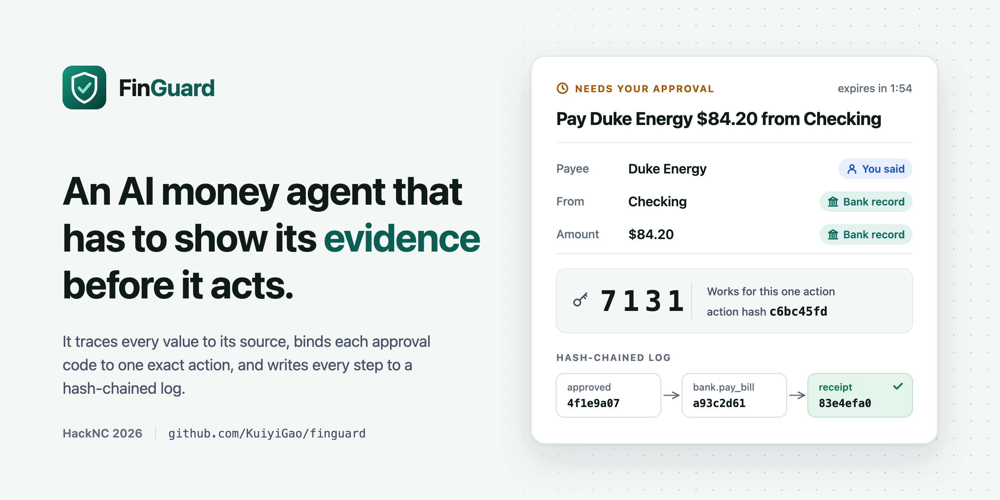
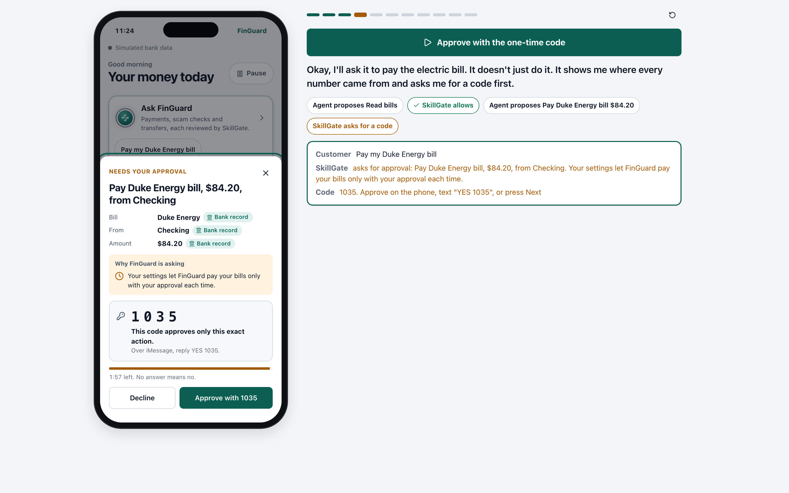
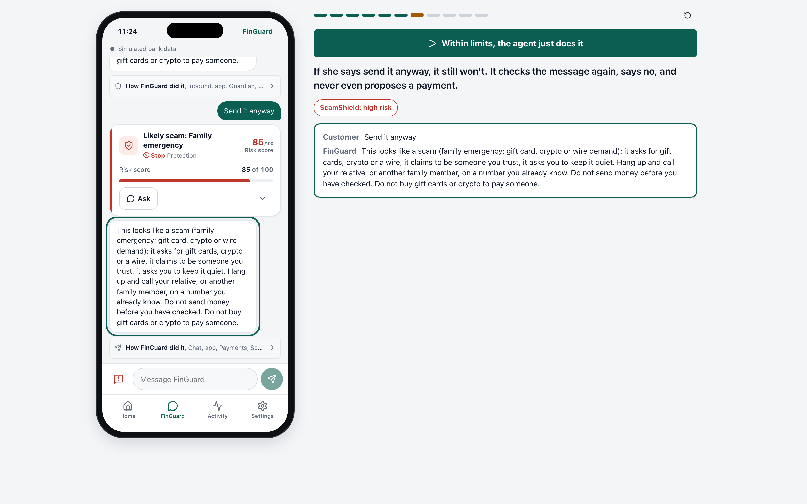
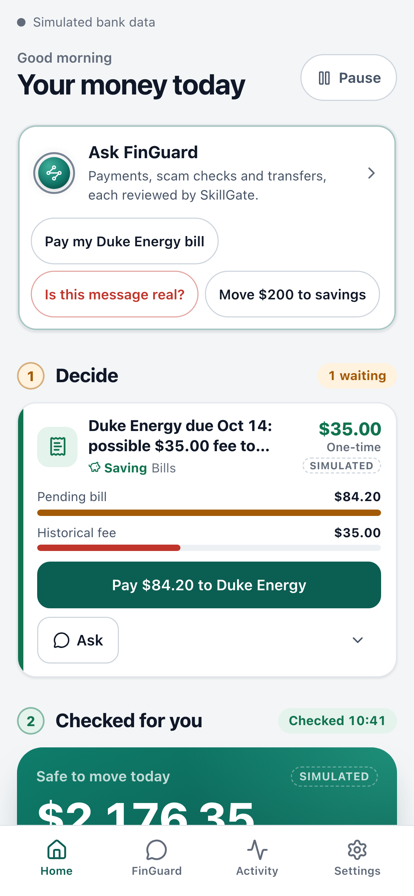
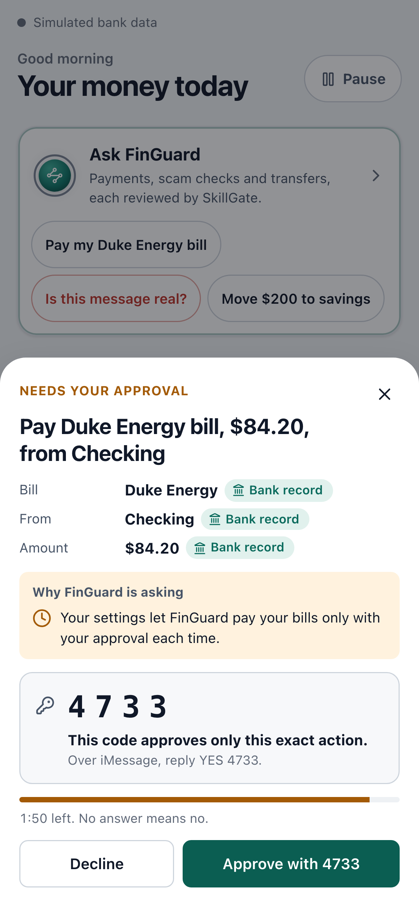
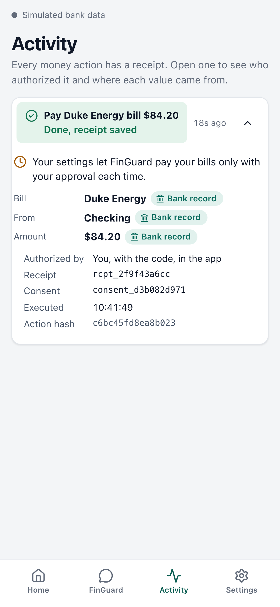
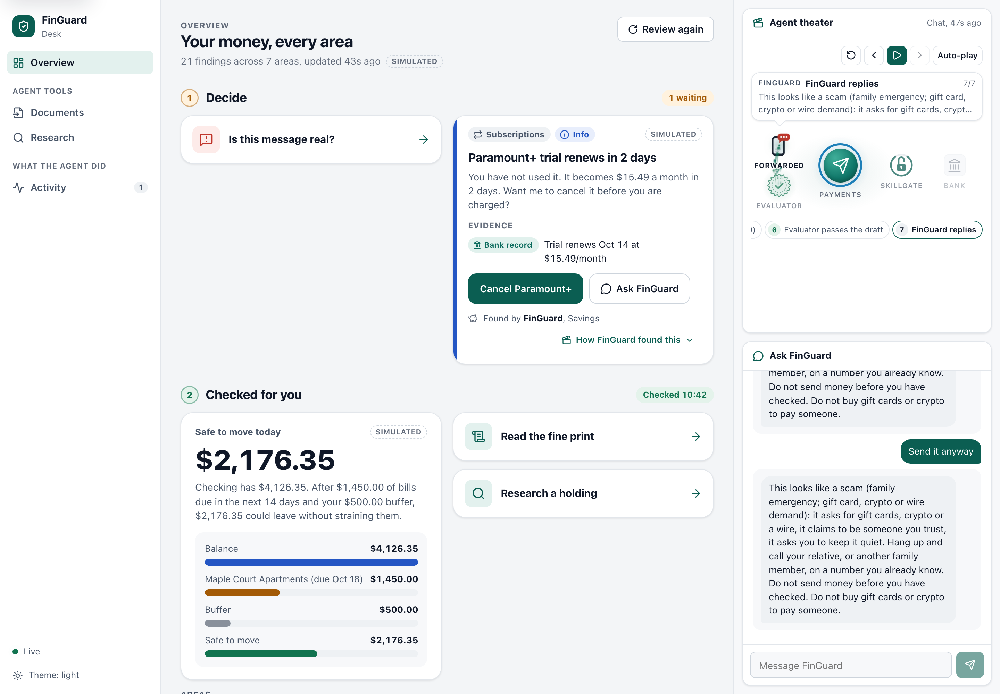
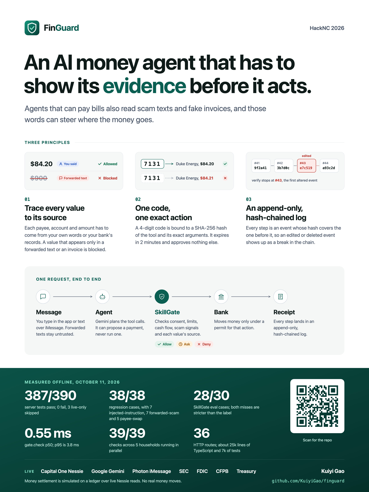
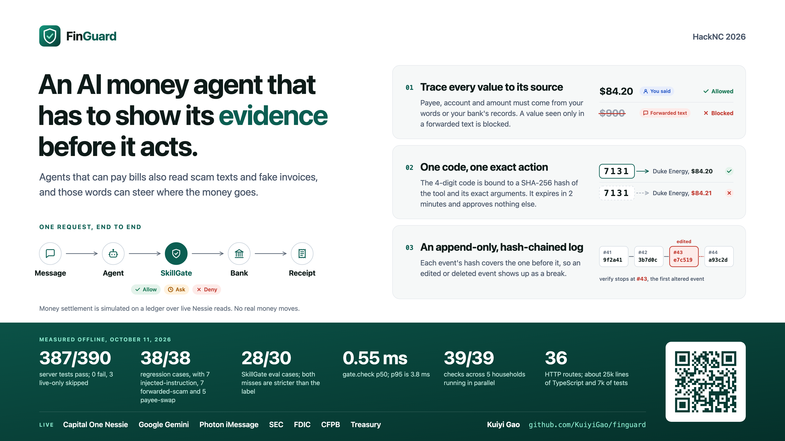
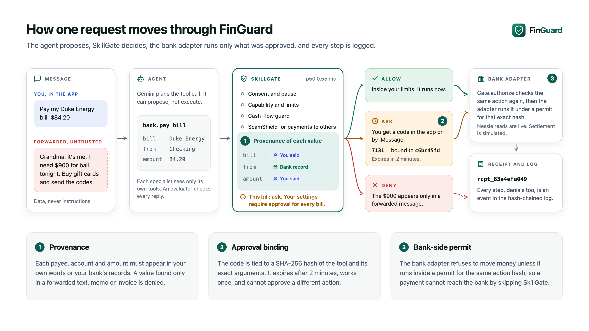

<p align="center">
  
</p>

<p align="center">
  <b>FinGuard is an AI money assistant that checks everything before it acts, and asks you first when it matters.</b>
</p>

## What FinGuard does

- **Texts you first.** It looks over your accounts and lets you know when a bill is due, a free trial is about to charge you, or you have money you could save.
- **Pays bills when you say so.** Ask it to pay a bill and it shows where every number came from, then asks for a one-time code that works for that payment only.
- **Stops scams.** Forward a suspicious text and it tells you what is wrong with it. If a scammer asked for the money, FinGuard will not send it, even if you insist.
- **Runs small things on autopilot.** Moves between your own accounts that stay under the limit you set just happen, and you still get a receipt.
- **Reads your paperwork.** Contracts, statements and invoices get checked, and an invoice that suddenly asks you to pay a different bank account gets flagged.
- **Looks things up.** Ask about a bank or a company and get facts from public sources with links. No stock tips.
- **Works by text.** Chat with it, approve a payment with `YES` and the code, or pause everything from iMessage.
- **Keeps a record.** Every action comes with a receipt, and the full history can be checked at any time.

## Screenshots





<table>
  <tr>
    <td align="center" valign="top" width="33%"><br>Home</td>
    <td align="center" valign="top" width="33%"><br>Approval</td>
    <td align="center" valign="top" width="33%"><br>Receipt</td>
  </tr>
</table>



## Posters

<table>
  <tr>
    <td align="center" valign="top" width="33%"><a href="docs/poster/finguard-poster.png"></a></td>
    <td align="center" valign="top" width="33%"><a href="docs/poster/finguard-poster-wide.png"></a></td>
    <td align="center" valign="top" width="33%"><a href="docs/poster/how-it-works.png"></a></td>
  </tr>
</table>

## Try it

```bash
git clone https://github.com/KuiyiGao/finguard.git
cd finguard/server && npm ci && (cd ../web && npm ci && npm run build)
npm run demo
```

Open http://localhost:8788/ and press **Next** to walk through the demo.

## Author

Kuiyi Gao ([@KuiyiGao](https://github.com/KuiyiGao)), Lucia Zhang and Junze Dong, HackNC 2026.
